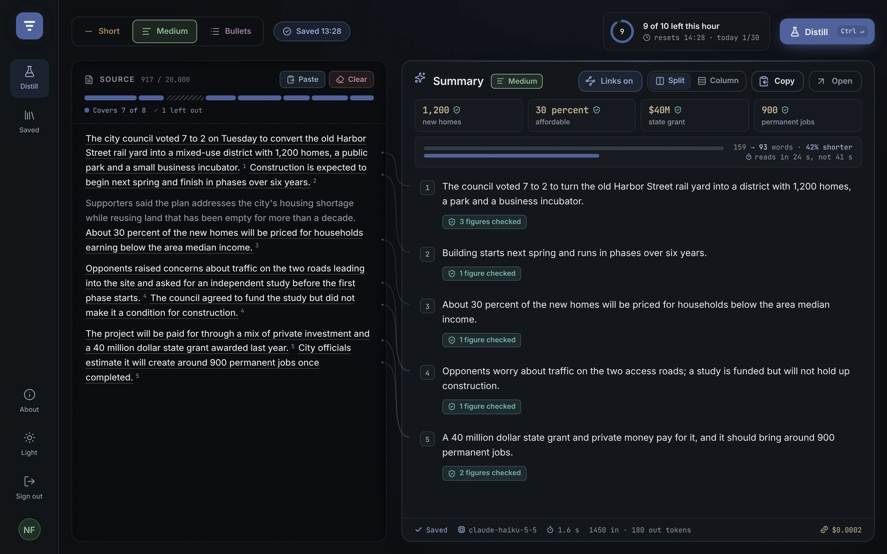
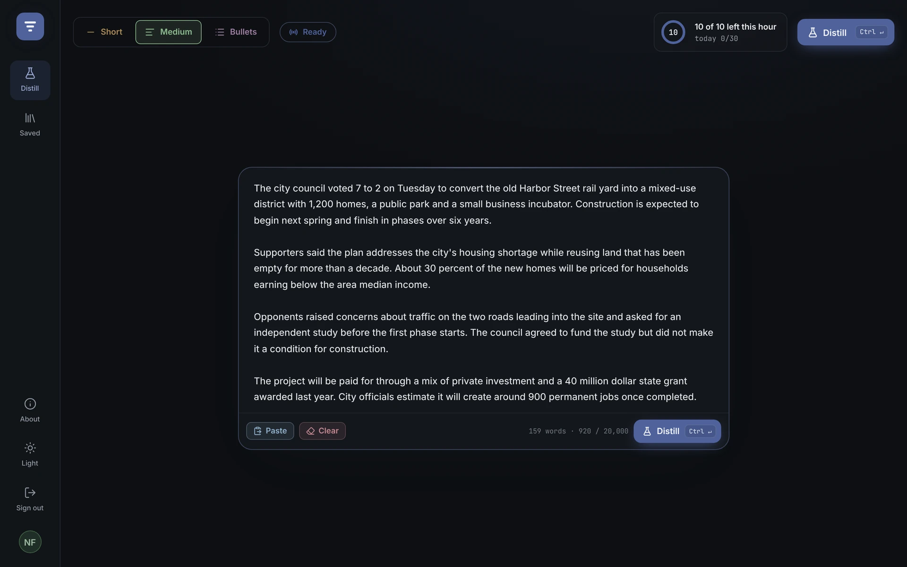
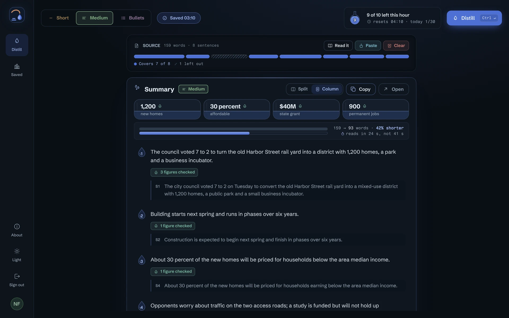
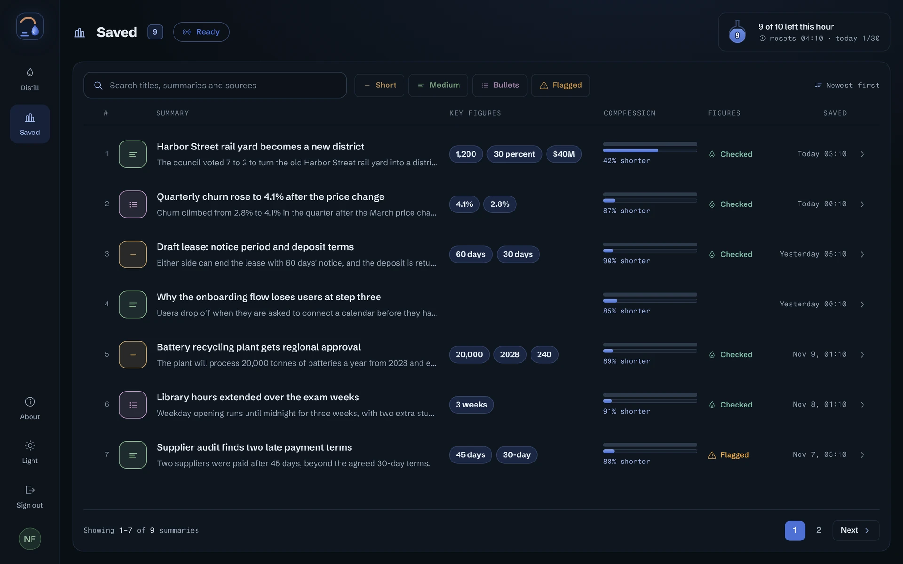
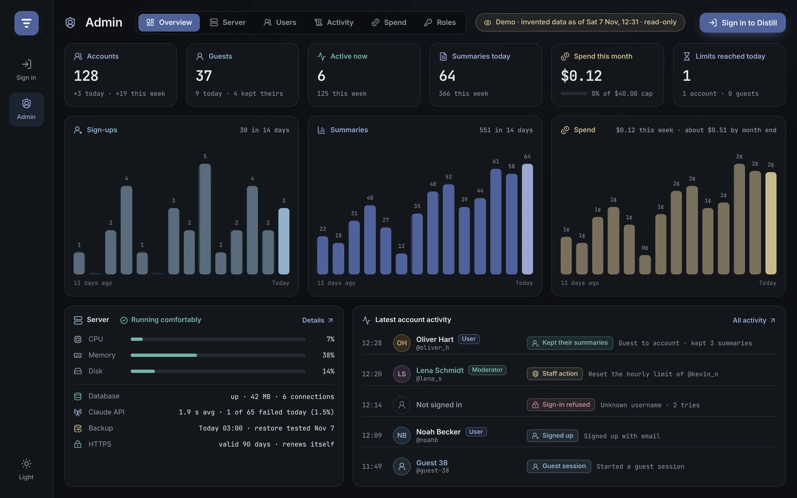
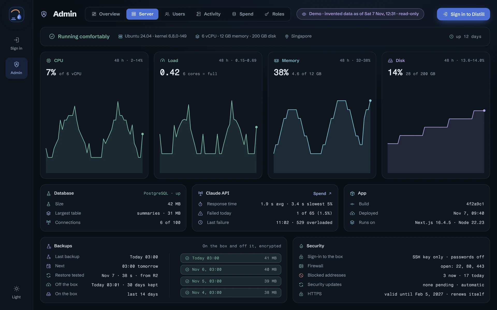
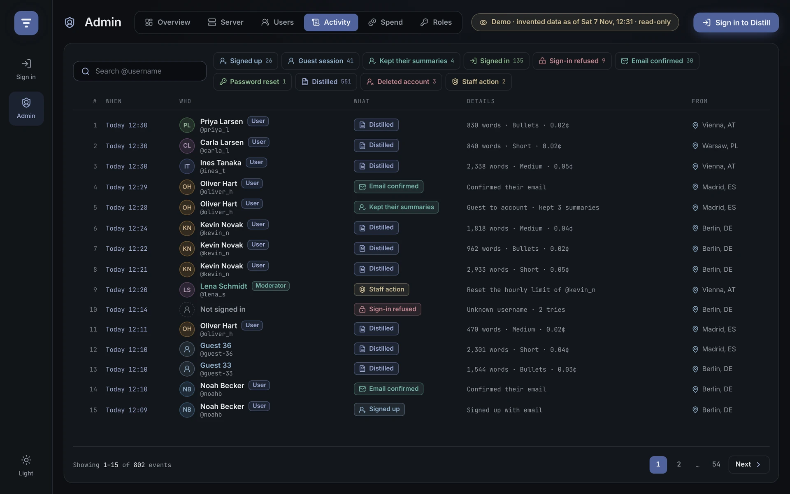
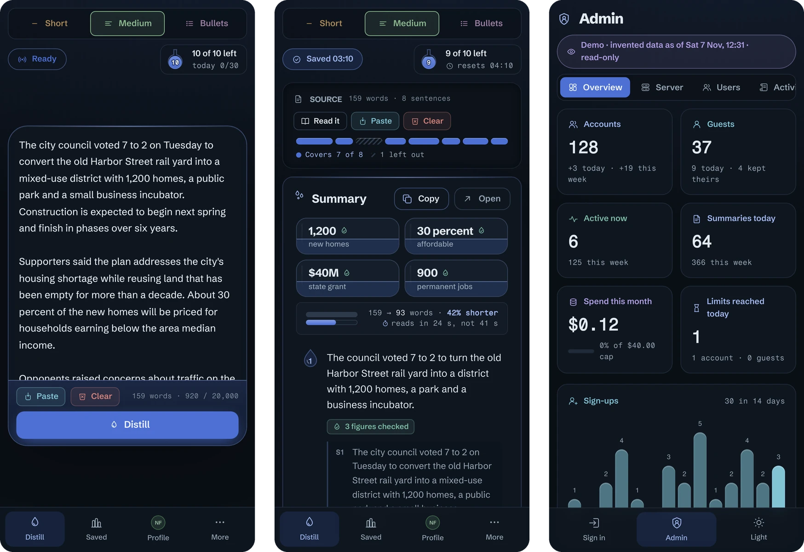

# Distill

**Summaries you can check.** Paste a text and Distill writes a short summary in which every point is linked to the
sentences it came from, and every number is checked against your text.

**Live:** [distill.jeromebadour.com](https://distill.jeromebadour.com) (try it as a guest, no account needed)  
**Admin console demo:** [distill.jeromebadour.com/demo/admin](https://distill.jeromebadour.com/demo/admin) (read-only, invented data)

<picture>
  <source media="(prefers-color-scheme: light)" srcset="docs/screenshots/result-light.webp">
  
</picture>

## Why it's different

Most summarizers give you a paragraph and ask you to trust it. Distill shows its work:

- **Every point is traceable.** Lines join each point to its source sentences, or, in the Column view, the sentences
  are quoted under each point. A coverage strip shows which parts of the text the summary used and which it left out.
- **Every number is checked.** Figures in the summary are matched against the sentences they cite. A figure that isn't
  in the source is flagged in amber instead of slipping through.
- **It never fails silently.** The real stages show as they happen (checking your limit, sending to Claude, writing
  points, linking to the source), and a failed request gives back the use it cost.

<table>
  <tr>
    <td width="50%"><picture><source media="(prefers-color-scheme: light)" srcset="docs/screenshots/composer-light.webp"></picture></td>
    <td width="50%"><picture><source media="(prefers-color-scheme: light)" srcset="docs/screenshots/column-light.webp"></picture></td>
  </tr>
  <tr>
    <td>Paste a text, pick a length (Short, Medium, Bullets), press Distill.</td>
    <td>Column view: the same summary with its sources quoted under each point.</td>
  </tr>
</table>

## A complete product, not a demo

**For the people who use it**
- Accounts with email confirmation and password reset, or a guest session that can be kept as an account later.
- Saved summaries with search and filters; a profile with your own numbers; export your data or delete your account.
- Sign out one device or all others; every ending (signed out, account deleted, password changed) says what happened.
- Light, dark and system themes, laptop and phone layouts, full keyboard use, and a short first-time tour.

<picture>
  <source media="(prefers-color-scheme: light)" srcset="docs/screenshots/saved-light.webp">
  
</picture>

**For the owner who runs it**
- An admin console: Overview, Server, Users, Activity, Spend and Roles.
- Roles (owner, admin, moderator) with permissions checked on the server. Every staff action asks for a reason and is
  kept in an append-only audit log.
- Staff see metadata only. Nobody, the owner included, can read users' texts or summaries from the console.
- Spend control: limits per user per hour and per day, daily and monthly caps that stop calmly before the provider's
  hard limit, and brakes to pause guests or everyone.
- Server health from the box itself: CPU, memory, disk, the database, Claude API errors, HTTPS, nightly backups and
  their restore tests.

<table>
  <tr>
    <td width="50%"><picture><source media="(prefers-color-scheme: light)" srcset="docs/screenshots/demo-overview-light.webp"></picture></td>
    <td width="50%"><picture><source media="(prefers-color-scheme: light)" srcset="docs/screenshots/demo-server-light.webp"></picture></td>
  </tr>
  <tr>
    <td>Overview: who uses it, what it costs, how the server is doing.</td>
    <td>Server: readings from the box every minute, backups and their restore tests.</td>
  </tr>
</table>

<picture>
  <source media="(prefers-color-scheme: light)" srcset="docs/screenshots/demo-activity-light.webp">
  
</picture>

**On a phone**

<picture>
  <source media="(prefers-color-scheme: light)" srcset="docs/screenshots/phone-light.webp">
  
</picture>

## How it's built

- **App:** Next.js 16 (App Router, server actions, streaming), React 19, TypeScript, Tailwind CSS 4.
- **AI:** Claude Haiku 5.5 through Anthropic's API. The source is sent as numbered sentences; the answer streams back
  as JSON lines; sentence ids the model invents are dropped and every figure is checked in code.
- **Database:** PostgreSQL 16 with row-level security. The app connects as a restricted role; limits, spend, staff
  actions and the audit log live in database functions, so no path through the app can skip them.
- **Accounts:** built in-house. Argon2id passwords; a random session token in an httpOnly cookie, with only its hash
  stored; codes and links for email that are stored as hashes, used once and limited in tries.
- **Hosting:** Docker Compose behind Nginx with HTTPS on a hardened Ubuntu server. Nightly backups are encrypted and
  copied off the server to Cloudflare R2, and a weekly test restores the newest copy and compares every table.
- **Deploys:** one command that refuses any commit CI hasn't passed, then builds, migrates, waits for the health check
  and checks the public site.

## How it's tested

Every push runs, in GitHub Actions:

- the type check, lint and unit tests;
- 16 database suites, each on a fresh database, that try to break the rules (limits, permissions, privacy, the audit
  log) and must fail to;
- 12 browser suites (over 400 checks) against the built container in Chromium, at desktop, laptop and phone sizes,
  with a stand-in for the Claude API so no test spends money;
- the backup, off-site copy and restore scripts, end to end.

## Run it locally

With Docker: make an env file with `POSTGRES_PASSWORD`, `DISTILL_APP_PASSWORD` (hex only) and `ANTHROPIC_API_KEY`,
then

```bash
docker compose --env-file <your env file> up -d --build
```

and open http://localhost:3101. The read-only admin demo is at `/demo/admin`.

---

Built by [Jerome Badour](https://jeromebadour.com/work/distill). [Work with me on Upwork](https://www.upwork.com/freelancers/~018fb626b478552f9f).

© 2026 Jerome Badour. All rights reserved. See [LICENSE](LICENSE).
